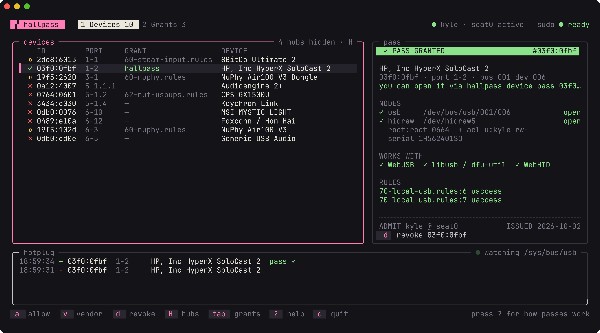
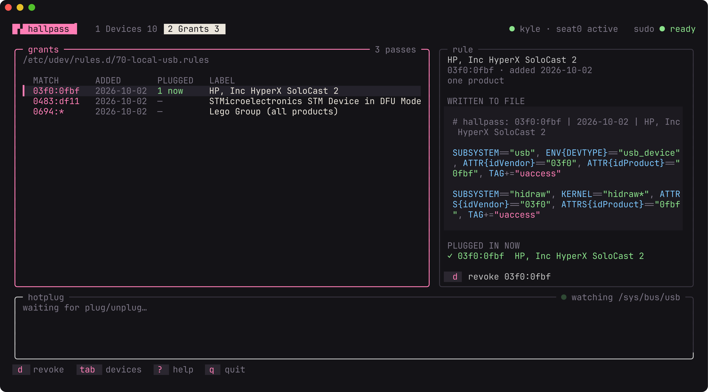

<h1 align="center">hallpass</h1>

<p align="center">
  Chrome can see the keyboard and still refuse to open it. hallpass writes the udev rule that lets you open it, as yourself.
</p>

On Linux, a browser flasher or a keyboard configurator dies with an error people paste straight into a search box:

```
SecurityError: Failed to execute 'open' on 'USBDevice': Access denied.
```

The page is running as you. The device node is `root:root` mode `0664`, so only root can open `/dev/bus/usb/…`. WebUSB tools fail with that exact `USBDevice` error. [VIA](https://usevia.app) and [Vial](https://get.vial.today), the WebHID configurators for QMK keyboards, fail with "Failed to open the device" until you can open the `hidraw` node. `dfu-util` and [QMK Toolbox](https://github.com/qmk/qmk_toolbox) need the same raw USB node as WebUSB. The fix is a udev rule, and the file name decides whether it works: `TAG+="uaccess"` in a file that sorts after `73-seat-late.rules` tags the device and grants nothing, with no warning. Vial's own docs used to install `99-vial.rules`, which is that failure.

hallpass writes the rule for you. Pick the device, press `a`, confirm sudo, and the node opens. No re-plug, no group membership, and the browser or flasher keeps running as you, not as root.

<p align="center">
  <a href="https://github.com/gig3m/hallpass/actions/workflows/ci.yml"></a>
  <a href="LICENSE"></a>
  
</p>

<p align="center">
  
</p>

## What it shows

- **Every USB device** with whether you can open it: ✓ open, ◐ only its HID side is open (WebHID works, WebUSB doesn't), ✗ root only.
- **Which rule is responsible**, across `/etc`, `/run` and `/usr/lib/udev/rules.d`, with ⚠ on rules that look right but grant nothing.
- **A pass card** for the selected device: its nodes, who has access, which tools will work (WebUSB, libusb / dfu-util, WebHID), and the rules that mention it.
- **Live hotplug**, so a device that drops off the bus while switching into bootloader mode is obvious.

<p align="center">
  
</p>

<p align="center">
  
</p>

The Grants tab lists your passes and the exact lines hallpass wrote for each.

## Install

Linux with systemd-logind, which is what turns `uaccess` into an ACL for the person at the active seat. You also need `udevadm` (systemd), `setfacl` from the `acl` package, and `sudo`.

A snap or Flatpak browser has a second sandbox. A udev pass does not cross it. Use a distro package of Chrome or Chromium, or connect that sandbox's USB permission yourself.

### Release binary

Each [release](https://github.com/gig3m/hallpass/releases/latest) has `hallpass_linux_amd64.tar.gz`, `hallpass_linux_arm64.tar.gz`, and `checksums.txt`. The archive contains the `hallpass` binary, `LICENSE`, and `README.md`.

```sh
curl -LO https://github.com/gig3m/hallpass/releases/latest/download/hallpass_linux_amd64.tar.gz
curl -LO https://github.com/gig3m/hallpass/releases/latest/download/checksums.txt
sha256sum -c --ignore-missing checksums.txt
tar -xzf hallpass_linux_amd64.tar.gz
mkdir -p ~/.local/bin
install -m 755 hallpass ~/.local/bin/hallpass
```

Use `hallpass_linux_arm64.tar.gz` on ARM64. `~/.local/bin` needs to be on your `PATH`.

### Go

```sh
go install github.com/gig3m/hallpass@latest
```

### Arch

Build the package from the PKGBUILD in this repo (it goes to the AUR once AUR registration reopens):

```sh
curl -LO https://raw.githubusercontent.com/gig3m/hallpass/main/packaging/arch/PKGBUILD
makepkg -si
```

### From a checkout

```sh
git clone https://github.com/gig3m/hallpass
cd hallpass
go build -o ~/.local/bin/hallpass .
```

## Usage

Run it as yourself. hallpass calls `sudo` for the one step that writes the rules file, and it refuses to run as root: root can open everything, so the status column would be meaningless.

```
hallpass                      interactive TUI
hallpass list                 connected devices and whether you can open them
hallpass rules                current passes
hallpass allow VID[:PID]      pass for one device, or a whole vendor without :PID
hallpass revoke VID[:PID|*]   remove a pass
hallpass rewrite              regenerate the rules file in the current format (after upgrading)
hallpass --version
```

| Key | |
|---|---|
| `a` | allow the selected device |
| `v` | allow every product from its vendor |
| `d` | revoke |
| `H` | show or hide hubs |
| `tab`, `1`, `2` | switch tabs |
| `r` | rescan |
| `?` | help |
| `q` | quit |

Rows and tabs are clickable. If sudo wants a password, hallpass asks in its own prompt, and the apply dialog shows each step as it happens.

`list` and `rules` only read. `allow`, `revoke`, and `rewrite` are what call sudo.

## How it works

- **One file.** Passes live in `/etc/udev/rules.d/70-local-usb.rules`. Each one tags the device's raw USB node and its hidraw nodes with `uaccess`, and logind gives the user at the active seat an ACL on them. Nobody gets added to a group, and access follows whoever is logged in at the machine.
- **Numbered `70-` on purpose.** `uaccess` only takes effect in a file that sorts before `73-seat-late.rules`. A `99-mydevice.rules` with `TAG+="uaccess"` still tags the device but grants nothing, with no warning. hallpass marks rules like that with ⚠.
- **Applies immediately.** After writing the file it reloads udev and retriggers the matching devices, so access changes without a re-plug.
- **Revoke really revokes.** udev never removes an ACL it added, so hallpass strips it from connected devices first, then retriggers. If some other rule still grants access, the retrigger puts it back.
- **Vendor passes** are for devices that change product ID between modes. A LEGO hub is `0694:0009` normally and `0694:0008` in its bootloader, and a flasher needs both. A vendor pass is wider than a single device: every product ID from that vendor, including ones you plug in later.
- **A pass covers that device and nothing plugged into it.** The USB line matches with `ATTR`, so it does not walk up through parent hubs the way `ATTRS` does. The hidraw line matches `ID_VENDOR_ID`/`ID_MODEL_ID` from udev's `usb_id`, which name the nearest USB device. A pass for a hub does not open the keyboards plugged into it.
- **Safe with untrusted devices.** A device's name comes from the device itself, so hallpass strips control characters and newlines before it goes in a rules-file comment or on screen, and it refuses to write an entry whose ids are not four hex digits.
- **No lost updates.** hallpass reads the rules file right before writing it and the privileged step checks it hasn't changed since, under a lock, so two hallpass windows can't undo each other.

## Safety

A pass is a root-owned udev rule. It runs on every plug of a matching device. hallpass is deliberate about what that rule is allowed to say.

- It writes one file, `/etc/udev/rules.d/70-local-usb.rules`, mode `0644`. It does not edit rules it did not write.
- The grant is `TAG+="uaccess"`. logind then gives the person at the active seat an ACL. The node is not opened to every account on the machine, and you are not left in a group after you log out.
- Over plain SSH there is often no active seat, so a pass will not open the device there. The header shows when the seat is missing or inactive.
- Vendor passes (`v`, or `hallpass allow VID` with no product) match every product from that vendor. Use one when a bootloader changes the product ID. Prefer a single-device pass when one ID is enough.
- Device strings are untrusted input. They are stripped before they reach a comment. Entries that are not four lowercase hex digits are not written.
- sudo is used for the write, the reload, and the ACL strip. The TUI and `hallpass list` do their reading as you. Do not wrap the program in sudo.
- Two copies cannot clobber a file that changed underneath them. The privileged step exits and tells you to reload.
- Revoke uses `setfacl` and fails if `setfacl` is missing or cannot strip a node that is still there. Deleting the rules file by hand does not strip an ACL that is already on a connected device.

## Uninstall

Revoke each pass while hallpass is still installed, so the ACLs come off devices that are plugged in:

```sh
hallpass rules
hallpass revoke abcd:0123    # one product
hallpass revoke 0694:*       # a whole-vendor pass
```

Then remove the binary: delete `~/.local/bin/hallpass`, or `$(go env GOPATH)/bin/hallpass` if you used `go install`, or `sudo pacman -R hallpass` for the Arch package.

That leaves `/etc/udev/rules.d/70-local-usb.rules` only if a revoke did not delete the last pass. After the last revoke, hallpass removes the file.

If you delete that file yourself, udev will not put the ACL back on the next plug, but a device that is still plugged keeps the ACL it already has. Replug it, or revoke with hallpass before you remove the file.

## License

[MIT](LICENSE)
